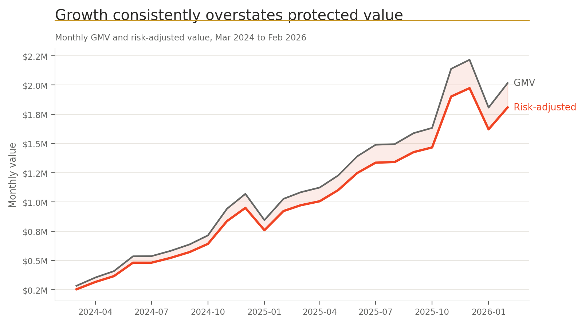
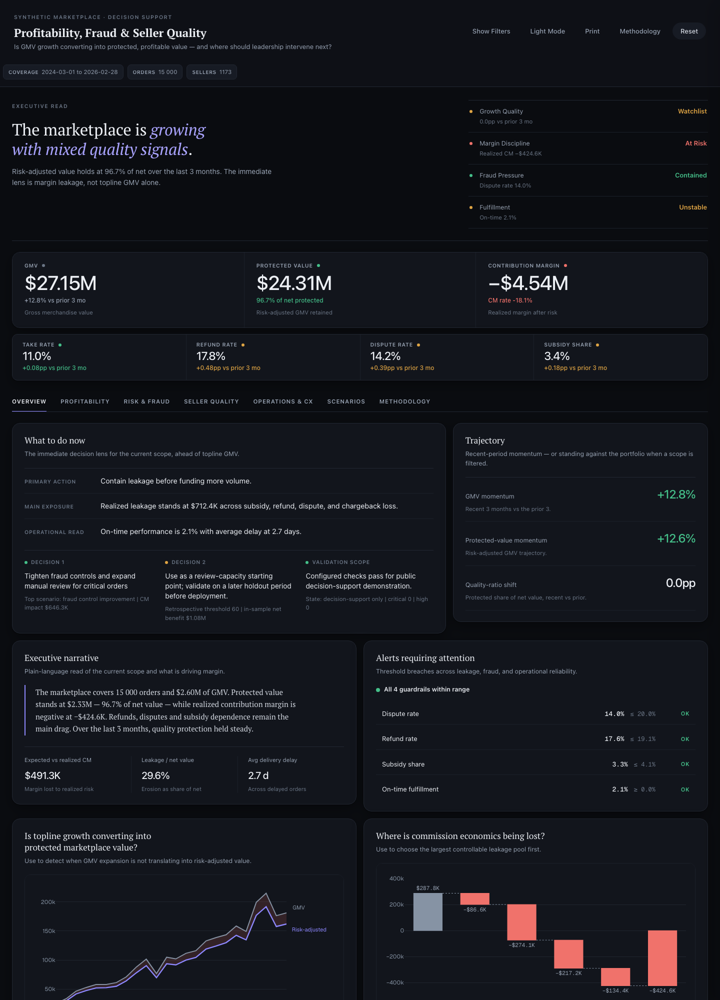
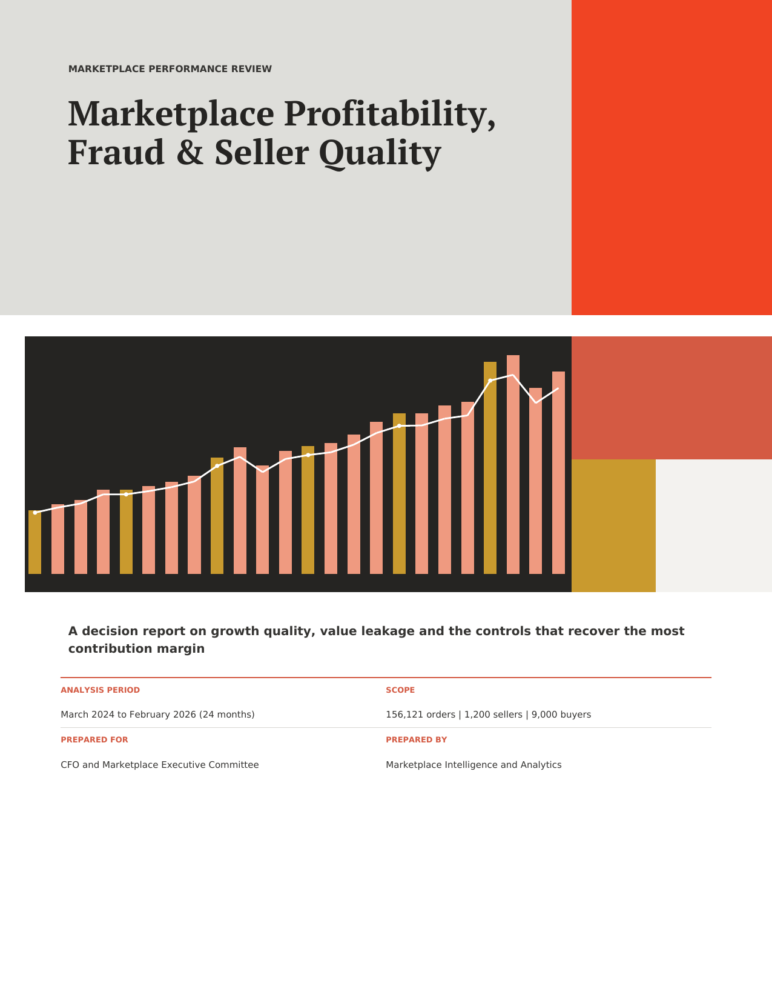
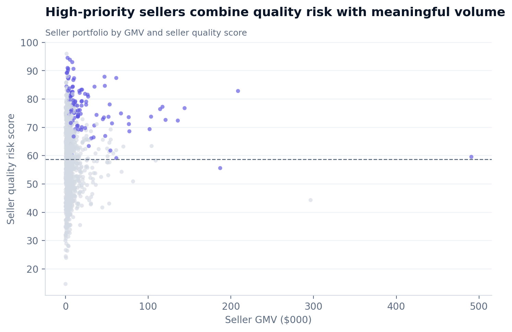
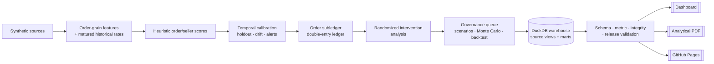

# Marketplace Profitability, Fraud & Seller Quality Command Center

A reproducible marketplace decision system spanning management P&L, point-in-time risk validation, controlled intervention design, seller governance, an analytical warehouse, and an auditable case-management API.

     

[](https://mfidalgomartins.github.io/marketplace-profitability-risk-command-center/) [](outputs/reports/marketplace-command-center-report.pdf)

**[Executive summary](docs/executive_summary.md)** · **[Architecture](docs/architecture.md)**

| GMV (current run) | Realized contribution margin | Top-10 seller GMV share | Model release status | Test suite |
|---|---|---|---|---|
| $27.15M | **-$4.54M** | 16.82% | `recalibration-required` | 161 passing · 88.7% coverage |



## The business question

Topline growth is not the control metric here. On the current synthetic run, GMV is $27.15M but realized contribution margin — after refunds, disputes, and chargebacks — is **-$4.54M**. No deterministic scenario in the governed scenario set restores positive margin; fraud and quality interventions reduce losses but do not solve the underlying economics on their own. That gap, not a vanity growth number, is what the dashboard and report are built to surface and route to owners. The full reasoning is in the [executive summary](docs/executive_summary.md) memo, generated from the same governed artifacts the dashboard reads.

## Flagship deliverables

### [Interactive dashboard](https://mfidalgomartins.github.io/marketplace-profitability-risk-command-center/) — the primary review surface



Built for a live seller-quality committee session, not a static export:

- **Ranked KPI band** — GMV, protected value, and contribution margin lead at 40px; take rate, refund rate, dispute rate, and subsidy share sit as a secondary diagnostic tier. The hierarchy mirrors the argument, not a flat grid of equally loud tiles.
- **Two-mode comparison** — unfiltered view shows trailing 3-month momentum against the portfolio; any scope filter switches every delta to "vs portfolio" instead. Filters drive the whole narrative, not just the charts underneath.
- **Guardrail checklist** — dispute, refund, subsidy, and on-time thresholds rendered as an OK/breach ledger, not a hidden alert log.
- **Scenario and threshold comparison** — the same Monte Carlo and backtest evidence behind the PDF, explorable live.
- Single self-contained HTML file (embedded Plotly + data), no backend, deployable straight to GitHub Pages.

### [Analytical report](outputs/reports/marketplace-command-center-report.pdf) — the primary decision-support deliverable



The narrative counterpart to the dashboard, typeset as a single production PDF: leakage waterfall, refund/dispute composition, seller governance distribution and concentration curve, model calibration and holdout evidence, and the scenario ranges behind the recommended policy. It states the model's failed release gate (ROC AUC 0.582 against a 0.600 threshold) in the same typographic voice as its passing gates — the report demonstrates model-risk control, not a manufactured "all green" outcome.

| | Dashboard | Report |
|---|---|---|
| Format | Self-contained HTML (Plotly) | Typeset PDF (PT Serif) |
| Use | Live filtering, scope drill-down | Fixed evidence pack for distribution |
| Audience | Working session, ad hoc queries | Committee review, offline reading |
| Source of truth | `reports/executive_kpi_snapshot.csv` + 15k sampled orders | Full 156k-order governed release |



## Architecture



Two deliberate runtime surfaces: a deterministic batch pipeline that produces every artifact above, and a separate case-management API (`src/api/`) that persists operational decisions. The static dashboard does not call the API — it stays self-contained and deployable without a backend. Full component responsibilities, data grains, and trust boundaries are in [docs/architecture.md](docs/architecture.md).

## What this project demonstrates

- Accounting-grade synthetic management accounts: one order subledger row per order, double-entry monthly journals, and cent-level reconciliation.
- Leakage-safe scoring: fixed ex ante priors, a 60-day outcome-maturation lag, and no current- or future-outcome leakage into historical scores.
- Model governance: logistic probability calibration, a maturation gap, a fully matured later-period holdout, an unmatured shadow window, monthly drift metrics, alerts, and explicit release gates.
- Experimentation: deterministic random allocation, covariate balance, power analysis, intention-to-treat estimates, seller-clustered standard errors, and segment diagnostics.
- Data engineering: an idempotent DuckDB catalog over raw and analytical CSVs with curated order, seller, finance, model-monitoring, and experiment marts.
- Operations: a FastAPI case workflow with deny-by-default bearer authentication, RBAC, optimistic concurrency, idempotent commands, manager approval, immutable events, and an HMAC-chained audit log.
- Publication: a standalone responsive dashboard, 20-chart evidence pack, and one production analytical report.

## Current evidence boundary

All data and intervention outcomes are synthetic. The system is suitable for portfolio demonstration and decision-support prototyping; it is not authorized for financial reporting, fraud enforcement, seller sanctions, or causal claims.

The current later-period holdout contains 42,688 fully matured orders. Calibration passes its Brier and expected-calibration-error gates, but ROC AUC is 0.582 against a 0.600 policy threshold. The governed status is therefore `recalibration-required`, and automated decisions remain `not approved`. Keeping this failed gate visible is intentional: the repository demonstrates model-risk control, not a manufactured "green" result.

## Data scope

The deterministic dataset covers March 2024 through February 2026.

| Entity | Rows |
|---|---:|
| Orders | 156,121 |
| Order items | 226,097 |
| Sellers | 1,200 |
| Buyers | 9,000 |
| Products | 20,326 |
| Refund events | 27,835 |
| Dispute events | 22,146 |

Current economics assume one seller per order. The release gate blocks publication if this grain changes without a governed allocation model.

The threshold backtest remains retrospective and in-sample. It is a capacity-planning input, separate from the later-period holdout and the synthetic randomized trial.

## Documentation

| Document | Covers |
|---|---|
| [Executive summary](docs/executive_summary.md) | Situation, findings, materiality, risks, and recommended actions — memo format |
| [Architecture](docs/architecture.md) | System boundary, component responsibilities, contracts, trust boundaries, production scale path |
| [Methodology](docs/methodology.md) | Scoring, calibration, experimentation, and finance methodology detail |
| [Data dictionary](docs/data_dictionary.md) | Entity model, join paths, and every raw/processed dataset |
| [API operating guide](docs/api.md) | Case-management API auth, roles, and endpoint reference |
| [Validation report](reports/validation_report.md) | Formal release evidence and current limitations |

## Primary outputs

| Output | Purpose |
|---|---|
| [Dashboard](outputs/dashboard/executive-marketplace-command-center.html) | Interactive executive review surface |
| [Analytical PDF](outputs/reports/marketplace-command-center-report.pdf) | Full narrative and visual evidence pack |
| [`order_accounting_pnl.csv`](data/processed/order_accounting_pnl.csv) | Order-level management-accounting subledger |
| [`model_release_assessment.csv`](data/processed/model_release_assessment.csv) | Holdout gates and automation guardrail |
| [`experiment_results.csv`](data/processed/experiment_results.csv) | Synthetic randomized-trial ITT estimates |
| [`governance_action_register.csv`](data/processed/governance_action_register.csv) | Owned seller/order intervention queue |
| [`warehouse_validation.csv`](reports/warehouse_validation.csv) | DuckDB source and curated-mart checks |
| [`validation_report.md`](reports/validation_report.md) | Formal release evidence and limitations |

The DuckDB database is a reproducible local runtime artifact at `outputs/warehouse/marketplace.duckdb` and is intentionally not versioned. Run `make warehouse` to synchronize it.

## Run locally

Requires Python 3.12+.

```bash
make setup
make all
make verify
```

`make all` rebuilds the complete governed pipeline. Normal runs validate the committed schema contract but cannot rewrite it. Intentional schema changes use `make update-schema-contracts`, followed by review of the contract and drift report.

Useful focused targets:

```bash
make model-validation
make finance
make experiment
make warehouse
make api
```

The API starts in fail-closed mode: health endpoints remain available, but protected routes require configured token hashes and a 32-byte-or-longer audit HMAC key. See [docs/api.md](docs/api.md) before running `make api`.

Run the batch pipeline in Docker:

```bash
docker build -t marketplace-command-center .
docker run --rm -v "$PWD:/app" marketplace-command-center
```

## Repository structure

```text
config/contracts/   schema, metric, model, finance, and experiment policies
data/raw/           deterministic synthetic sources
data/processed/     analytical, accounting, model, experiment, and governance outputs
docs/               architecture, methodology, data, API, and executive documentation
outputs/dashboard/  standalone interactive dashboard
outputs/graphs/     publication chart pack
outputs/reports/    single production analytical PDF report
reports/            KPI, warehouse, validation, and release evidence
src/api/            secured case-management service and SQL migration
src/warehouse/      idempotent DuckDB catalog and curated marts
src/                batch analytics, governance, validation, and publication modules
tests/              unit, integration, API, accounting, experiment, warehouse, and artifact tests
```

## Roadmap

The implemented boundaries are designed for replacement without changing business contracts — this is the concrete production path, not aspirational:

- Move CSV source views to partitioned Parquet or a managed warehouse.
- Run the same ordered pipeline steps under Airflow, Dagster, or a cloud scheduler with persisted run metadata.
- Replace SQLite with managed PostgreSQL under the existing migration and transaction semantics.
- Replace local bearer-token provisioning with OIDC/JWT verification and centralized policy.
- Bring in real prospective shadow data, controller-approved accounting rules, and a pre-registered live experiment to replace the current synthetic evidence.
- Route alerts, audit anomalies, and case SLA breaches into operational monitoring.

## Quality and release status

CI rebuilds governed artifacts and runs formatting, lint, static types, Bandit, dependency audit, compilation, and tests with an 85% coverage floor. The current local suite passes 161 tests at 88.73% total source coverage.

Formal validation currently reports 0 critical issues, 0 high issues, and 1 medium model-monitoring warning. The public artifact state is `decision-support only`; committee-grade and automated-decision flags remain false.

## License

[MIT](LICENSE)

The analytical PDF embeds [PT Serif](https://github.com/google/fonts/tree/main/ofl/ptserif) under the [SIL Open Font License 1.1](assets/fonts/OFL.txt).
